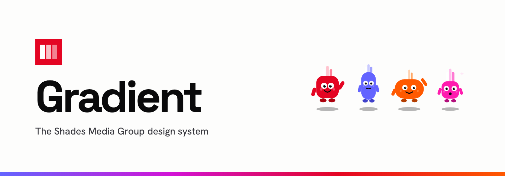

<a id="top"></a>

<p align="center">
  <picture>
    <source media="(prefers-color-scheme: dark)" srcset="assets/readme-banner-dark.png">
    
  </picture>
</p>

<h3 align="center">The design system every Shades product is built from.<br>One mark, one red, seven characters, and the code to ship them.</h3>

<p align="center">
  <a href="https://github.com/Shades-Media-Group/gradient/actions/workflows/ci.yml"></a>
  <a href="https://www.npmjs.com/package/shades-gradient"></a>
  <a href="LICENSE"></a>
  <a href="TRADEMARKS.md"></a>
</p>

<p align="center">
  <a href="https://gradient.shades.md"><b>Website</b></a> ·
  <a href="https://gradient.shades.md/brand/"><b>Brand</b></a> ·
  <a href="https://gradient.shades.md/foundations/"><b>Foundations</b></a> ·
  <a href="https://gradient.shades.md/components/"><b>Components</b></a> ·
  <a href="https://gradient.shades.md/icons/"><b>Icons</b></a> ·
  <a href="docs/README.md"><b>Docs</b></a>
</p>

<p align="center">
  The website in
  <a href="https://gradient.shades.md/">English</a> ·
  <a href="https://gradient.shades.md/fr/">Français</a> ·
  <a href="https://gradient.shades.md/ro/">Română</a> ·
  <a href="https://gradient.shades.md/ru/">Русский</a> ·
  <a href="https://gradient.shades.md/es/">Español</a> ·
  <a href="https://gradient.shades.md/zh/">中文</a>
</p>

## What it is

Shades Media Group is called Shades, and a gradient is what shades make when they sit side by side. Gradient is where the Shades brand and the code behind it live together:

- **Brand:** the mark and lockup, drawn from one geometry; the seven Spectra characters; the voice rules; print and merchandise.
- **Foundations:** colour, roles for light and dark, type, space, radius and motion. Each is written once, in [`tokens.json`](packages/gradient/src/tokens.json).
- **Code:** the [`shades-gradient`](packages/gradient) npm package. It ships CSS custom properties, framework-free component classes, a Tailwind v4 theme, DTCG token JSON, 76 Shades icons and the brand SVGs.
- **Lessons:** how each Shades product was made, and the patterns its owner rejected, so the next one starts further ahead. See [docs/projects](docs/projects).

## Install

```bash
npm i shades-gradient
```

Any project:

```js
import 'shades-gradient/gradient.css'
```

```html
<button class="g-btn g-btn--primary">Send the brief</button> <span class="g-tag">Branding</span>
```

Tailwind v4:

```css
@import 'tailwindcss';
@import 'shades-gradient/theme.css';
```

```html
<a class="bg-accent text-on-accent rounded-pill px-6 py-3">Start a project</a>
```

Icons, as strings or from the sprite:

```js
import { renderIcon } from 'shades-gradient'

button.innerHTML = renderIcon('arrowRight', 20)
```

The [package README](packages/gradient/README.md) covers every export. The [using the package](docs/guides/using-the-package.md) guide covers React, Preact, plain HTML and client themes.

## What's inside

| Part       | Where                                                                    | Ships as                                                                                                                            |
| ---------- | ------------------------------------------------------------------------ | ----------------------------------------------------------------------------------------------------------------------------------- |
| Tokens     | [`packages/gradient/src/tokens.json`](packages/gradient/src/tokens.json) | `tokens.css`, `theme.css` (Tailwind v4), `tokens.json` (DTCG)                                                                       |
| Components | [`components.css`](packages/gradient/src/components.css)                 | `.g-btn`, `.g-input`, `.g-switch`, `.g-segmented`, `.g-tag`, `.g-badge`, `.g-disclosure`, `.g-table`, `.g-loader`, `.g-spectrum`, … |
| Motion     | [`motion.css`](packages/gradient/src/motion.css)                         | snap, pop, move and the Spectra idles; all stop under reduced motion                                                                |
| Icons      | [`packages/gradient/icons/`](packages/gradient/icons)                    | 76 hand-drawn SVGs, `renderIcon()`, `icons.svg` sprite                                                                              |
| Logo       | [`packages/gradient/brand/`](packages/gradient/brand)                    | mark, lockup, reverse and one-colour versions                                                                                       |
| Spectra    | [`packages/gradient/brand/spectra/`](packages/gradient/brand/spectra)    | Spectra, Mera, Sol, Nova, Sage, Vio, Sunny                                                                                          |
| Website    | [`apps/site`](apps/site)                                                 | 42 static pages in six languages on a Cloudflare Worker                                                                             |

## The rules that matter most

1. **The logo comes from shades.md.** It is a sharp red `#E40523` square with three white bars at 100%, 75% and 50%. Every logo file is generated from that geometry by `yarn brand`. Nothing is redrawn by hand.
2. **Red is the signal.** It goes on the mark, the one primary action on a screen, and at most one chapter per page. The four-shade spectrum appears once per layout.
3. **Show the real thing.** No fake windows, skeleton drawings, monospace costumes, labels above headings or icons on every row. The full list is [docs/lessons.md](docs/lessons.md).
4. **Fast by default.** Static HTML, self-hosted fonts, no third-party requests, a strict CSP. The site audit fails any page that breaks its byte budget.

## Develop

Needs Node 22 (`.nvmrc`) and Yarn 1.

```bash
yarn install
yarn dev:site        # the website with live reload
yarn verify          # typecheck, lint, tests, package build, site build and audit
yarn audit:layout    # every page, every language, phone and desktop
yarn deploy:site     # build, audit and publish to gradient.shades.md
```

Other scripts:

- `yarn brand` writes the logo files.
- `yarn --cwd packages/gradient icons` rebuilds the icon module from `icons/*.svg`.
- `yarn assets` renders the social card and the banners.
- `yarn release <patch|minor|major>` cuts a version.

[CONTRIBUTING.md](CONTRIBUTING.md) explains how the code is organised and what a pull request needs.

## Licence and brand

The code is [MIT](LICENSE): use the tokens, components and icons in anything. The Shades name, the mark and the Spectra characters are trademarks of Shades Media Group. The MIT licence does not cover them; [TRADEMARKS.md](TRADEMARKS.md) explains what that means in practice.

<p align="center">Built by <a href="https://github.com/CristianBrinza">Cristian Brinza</a> | <a href="https://shades.md">Shades Media Group</a></p>

<p align="right"><a href="#top">Back to top</a></p>
